# Kaaval

**Kaaval** (Tamil காவல், "guard") reviews open-silicon analog chip designs the way a senior analog engineer would.
Paste a repository: Kaaval rebuilds every circuit from the schematics as text, **Muse Spark plans the tests the
designer never ran** (power-up from 0 V, loop stability, corners, and the block **in its chip context**: which rail
comes up first, how fast, when enables and resets are released, the load of the chip's pad), and the simulator proves
every finding at **5 process corners × 3 temperatures × 3 supplies**, before the fab finds it for you.

Why the chip context: an analog block is usually simulated alone, with every supply switched on together. On the chip,
rails come up in some order and at some speed, controls arrive late and the output drives a pad. Tiny Tapeout's
precheck runs no simulation, so nothing checks this before the fab.

Built for the Meta Global AI Developer Hackathon (Oct 26 – Nov 4, 2026). Everything in this repository was written
during the event; see [What runs where](#what-runs-where).

## What it catches

| Failure in silicon | How Kaaval proves it | Measured on our own circuits |
|---|---|---|
| **It wakes up dead.** A self-biased reference has a second, 0 A solution. | Every source ramps from 0 V and is held; a dead state counts only when the supply current settles there. | Our beta-multiplier reference without a start-up device: **30 of 45 conditions stay at 0 µA** while DC analysis reports a working bias at every one (8.3–14.5 µA). With one weak start-up PMOS: **0 of 45**. |
| **It settles in the wrong state.** | The settled state is handed back to the DC solver; it counts only if the solver keeps it (a real second operating point). | Tests: a seeded reference without start-up caught at every condition; an inverter at its trip point (high gain, one state) correctly passes. |
| **It rings or never settles.** | Every loop the designer closed in a testbench (an instance whose output returns to its own input, found from the netlist and the symbols' pin directions) is cut at that output, with no planner needed; the planner can cut others. Loop gain is measured by double injection (Tian's method): phase margin, gain margin, unity-gain frequency at every condition. A condition is judged only where the loop is an amplifier in negative feedback (DC loop gain 0–140 dB): a latch or a 555 timer's loop is not. | Matches the exact return ratio of a test loop to the digit (UGF 8.894 MHz, PM 117.262°, GM 22.707 dB). Our two-stage op-amp: PM 82° with a 2 pF Miller capacitor; with 0.5 pF, 44° → 21° as the load grows from 2 to 10 pF; a 0.2 V step overshoots 0 % / 17 % / 38 % at 82° / 44° / 21°. |
| **It works only if the chip powers up in the right order.** A start-up that depends on another rail, or on a control pin. | Muse Spark labels each pin (supply, ground, enable, reset, output) and picks the sequences: every rail first in turn with the others 10 µs, 100 µs or 1 ms later; fast (2 µs) and slow (1 ms) ramps; controls with the rails or 20 µs after them. Outputs drive the pad path (under 500 Ω and 5 pF, TT's analog spec). A failure is reported with the gap at which it starts failing and the largest gap that still passes, never one chosen gap. | Our reference on the 1.8 V rail kicked from the 3.3 V rail: starts with the rails together, **stays off when 3.3 V leads by 1 ms, starts at 100 µs**. With its own start-up device: passes every sequence. Enables and resets can also follow **the project's own logic**: a digital simulation's VCD gives the release time (`tools/logic_wave.py`). Our power-down pin, released by our counter 54.5 µs after the rail: the kick-started reference stays off (0.33 nA instead of 7.2 µA). |
| **A 1.8 V transistor sees 3.3 V.** A missing level shifter, or a block that is unsafe while one rail is still off. | Every transistor's voltages are solved with all rails on and with each rail off while the others are up, and judged against its sky130 rating (`_01v8` 1.8 V, `g5v0d10v5` 5 V gate / 10 V drain; a finding above 1.1× the rating). | Our 3.3 V inverter driving 1.8 V gates directly: 3.30 V gate-source on a 1.8 V NMOS. Thick-oxide receiver: passes. A 1.8 V switch with a 3.3 V pull-up: safe with both rails up, 3.30 V gate-drain while the 1.8 V rail is off. |
| **What you measure depends on your meter.** An output that leaves the chip with no buffer. | The output is put on the Tiny Tapeout pad path (under 500 Ω, 5 pF) and its load swept: open, 10 MΩ, 1 MΩ, 100 kΩ, 10 kΩ. Output resistance is estimated; a finding when 1 MΩ, TT's recommended minimum board pull-down, moves it more than 2 %. | Our 100k/100k divider reference: about 50 kΩ, flagged; 1k/1k: passes. |
| **It loses its margin at a corner.** | The designer's own testbench at all 45 conditions; every transistor's saturation margin and bias tracked, down to the sub-circuit it lives in. | Measured on 8 testbenches (our demo and 7 from cloned repositories): all 45 conditions in 1.1–2.0 s for 6 of them; 50 s and 124 s for the two largest (67–68 devices). |
| **The simulation itself is wrong.** | Units audit: device sizes read as text, checked against what the silicon can be. | Found in 6 Tiny Tapeout repositories: diodes whose area reads as 1 m² under `.option scale`. |

Every number above comes from ngspice-47 with the open sky130 PDK. Kaaval is **pre-silicon simulation on open PDKs,
not foundry sign-off**; one measured run is not a guarantee.

## How a review works

1. **Read.** Schematics (xschem) and SPICE netlists are parsed as text and netlisted the way xschem would
   (95.3 % of 8,394 devices identical on 434 xschem-written netlists). Nothing in the repository is ever executed.
2. **Plan (Muse Spark).** Muse Spark reads the docs and every circuit cell, names each block and its risks, labels
   the job of every pin with its evidence, and writes test plans as JSON (a strict schema). Plans are data: the engine checks every cell, port and value before anything
   runs, and refuses raw SPICE. Without a Muse Spark key, a labelled no-model baseline powers up every circuit.
3. **Prove.** The engine builds every deck itself and simulates at all 45 conditions. A finding is shown only after
   its own confirmation (second states re-solved, oscillations re-run with a stiffer integrator). A power-up result is
   accepted only at a fine time step: the default step must agree with a 2 ns maximum step, or 2 ns with 1 ns (two
   coarse steps can agree on a wrong state). When completed runs disagree, Kaaval reports a **marginal start-up** (the
   state reached depends on numerical detail, so on silicon it depends on noise and ramp) instead of a pass or a fail.
   Each test has 300 s for the fine-step runs; on a cell too large for that (a whole SAR ADC with its DAC) the
   remaining conditions are **unconfirmed**: shown as not tested, counted on the review, never a pass or a finding.
   A whole review is bounded too: the planned tests share 600 s of simulation (a power-up gets twice the share of
   other tests; time one test does not use passes to the next), and a condition not reached in its share is listed
   as **not run**. On a 161-device flash ADC the full review takes 610 s instead of 1,968 s with the same findings,
   and 72 of its 165 power-up conditions are then not tested (`KAAVAL_PLAN_BUDGET` raises the budget; 0 removes it).
4. **Fix.** A proposal, never a merge: a sizing fix is re-simulated at all 45 conditions before it is shown.

The review page shows the evidence behind each finding: the failing device on its own schematic sheet, the
conditions where it fails, a **sequence matrix** (every power-up order against every condition, click a cell for its
waveform), the **power-up waveform** of any condition (simulated on click), and the **Bode plot** of a
loop at every condition. Each finding of a planned test also downloads as a zip a designer can check without Kaaval:
the finding, the test plan, every condition measured, and the testbench at the worst condition as a plain ngspice
deck (your cell unchanged, the standard sky130 `.lib` line, no server paths). For a power-up finding the deck runs
both sides: the DC answer, then the same power-up from 0 V the engine ran.

## Layout against schematic: is the chip the circuit you simulated?

A designer simulates the schematic; the fab builds the layout. Every cell a repository draws both ways (xschem
`<cell>.sch` and Magic `<cell>.mag`) is compared at transistor level: Magic extracts the layout's devices, our netlister
flattens the schematic (with the PDK's standard cells it uses), and Netgen, the open LVS tool, matches them with the
sky130 setup (`kaaval_engine/layout_check.py`). A review reports:

- **different devices**: a threshold flavour or resistor type changed (`pfet_01v8` drawn where the schematic has
  `pfet_01v8_hvt`), or devices missing or added after Netgen's own merging of parallel devices;
- **different sizes**: the same circuit with other W / L / values (a warning above 5 %, a note below);
- **dummies**: extra devices that are off, shorted, or drive nothing, said so instead of an error;
- **ideal parts**: the schematic simulates parts with no PDK model (a capacitor written as its value, an R with no
  model, a 0-ohm link) that no layout can draw, a note naming them; a fixed-width poly resistor
  (`res_high_po_0p69`) is compared as the generic model at that width, as a schematic draws it;
- **bodies untied**: the layout leaves transistor bodies (an n-well, the substrate) on a net that reaches nothing
  else, and with them tied as the schematic ties them Netgen matches: a note in a sub-cell (a tap above must tie
  them), a warning in a project's top cell. A pin drawn in unconnected pieces is checked the same way: joined, does
  the cell match?

It judges only what it can see whole: a schematic that uses cells it cannot resolve (a library outside the
repository), or a difference only in pin or net names, is reported as not judged. A mismatch shows that the committed
layout and schematic differ: either the chip is not the circuit that was simulated, or the schematic is out of date.

Measured on 98 cloned Tiny Tapeout analog repositories (451 cells drawn both ways, median 0.18 s per cell):
274 match; 51 warnings in 26 repositories (36 with different devices, 15 with sizes more than 5 % off); notes on 28
cells that are the same circuit with ports named or wired otherwise, 13 with small size differences and 5 with
layout dummies; 12 that are the same devices plus ideal schematic parts (18 or 36 ideal 10 fF loads in ring
oscillators, for instance); 6 in 4 repositories that are the same circuit with transistor bodies left untied (all
sub-cells); 7 cells draw a pin in unconnected pieces (1 a project's top cell), 4 of them the same circuit once the
pieces are joined; not judged: 28 whose pins or wiring Netgen could not match, 8 empty layout views, 6 using cells we cannot resolve, 16 that could not be compared.
Counts only; results on other people's designs are not published. (An earlier count, 253 match and 60 warnings,
included 12 cells whose resistors and sources our netlister had dropped: symbols named by bare name or by another
machine's PDK path, fixed in #154.)

**As drawn, with its capacitance.** A layout that matches its schematic device for device still adds the capacitance
of every wire, junction and overlap. For such a cell, the review runs its own power-up or stability test again,
unchanged, on the layout extracted with those capacitances (`kaaval_engine/postlayout.py`), and reports where the
drawn chip comes up in another state, rests at another current or loses phase margin. Wire resistance is not
extracted. Only tests that drive every input are compared: in a pilot on 8 matched cells with the no-model
baseline's tests, all 3 'differences' were inputs left floating (where a floating input settles depends on that very
capacitance), and the one cell with every pin driven agreed. Muse Spark's planned tests, which bias the inputs, are
what this comparison runs on.

## Kaaval Zoom: the whole chip, down to each transistor

A review's **Chip view** draws the project's whole Tiny Tapeout tile from its top module and `info.yaml`, read as text:
the 1.8 V and 3.3 V rails, the analog pads `ua[0..5]` (paid ones marked), the digital pads, and every block with each
pin wired to what it reaches. Digital blocks and analog blocks are told apart; click an analog block to open its
schematic, its pins and every test Kaaval ran on it with what it found; click a pin to trace its wire.

## Silicon Twin: from what the chip did back to why

A bring-up report says what the fabricated chip showed at one node. `tools/silicon_twin.py` rebuilds the block in its
chip context and searches what a bench changes: the load on the node (open, 10 MΩ meter, 1 MΩ, 100 kΩ, 10 kΩ), a
power-up from 0 V (step-checked) and the process corners. Each measured value is either reproduced, with the kind of
cause (the DC answer under that load: the reading is the load's doing; or the state a power-up lands in: the chip came
up in another operating point), or reported as not reproduced. It is a search over a fixed set of contexts, so a
match shows a possible cause: every result says how many contexts were tried and the span their values cover, and only
a match on the loads the bench really had (`--bench`) counts as reproduced; one that needs another load is reported as
possible. No circuit parameter is changed to match. Tests on our own circuits:
`tests/test_kaaval_twin.py`.

## Analog blocks in static timing

Digital timing tools (OpenSTA, OpenROAD) time paths from Liberty models; an analog macro has none, so the paths across
the digital-analog boundary go untimed. `tools/analog_lib.py` characterises an analog cell in ngspice the way standard
cells are (delay 50 %-50 %, output transition 20-80 %, input capacitance, over input slew x output load, per corner)
and writes a Liberty file per corner. A clocked comparator is timed like a flip-flop (clock -> output, rising_edge),
but its delay depends on the input difference: our own StrongARM latch decides in 100 / 146 / 193 / 222 ps at
100 mV / 10 mV / 1 mV / 0.1 mV (tt). So the Liberty file is characterised at the smallest difference the design
must resolve (half an LSB for an ADC) and says which in its header. Tests on our own cells, checked with a real
Liberty reader (yosys): `tests/test_kaaval_liberty.py`.

An oscillator has no clock input; it runs from its supply (and a control voltage, for a VCO), so the clock it gives
the logic moves with process, temperature and supply. `kaaval_engine/clocks.py` powers it up at each condition,
measures period and duty cycle over several cycles, and writes `create_clock` on its output pin: one SDC per process
corner (that corner's shortest period) and one conservative SDC (the shortest anywhere). On our own 5-stage ring
the 45 conditions take 45 s: 1.133 ns at ff, -40 °C, 1.1x supply, to 3.573 ns at ss, -40 °C, 0.9x, with the duty
cycle at 46-53 % (the skewed corners move it). Jitter is not measured (a noiseless transient has none), so the SDC
leaves `set_clock_uncertainty` to the designer's jitter budget. Tests: `tests/test_kaaval_clocks.py`.

A comparator's timing model only means something at an overdrive it resolves. `liberty.offset_check` runs the PDK's
mismatch corner (every device drawn on its own, a seed per sample) and counts wrong decisions at ±overdrive: our
StrongARM latch decides wrong in 30 of 40 samples at ±1 mV and in none at ±20 mV, an input offset of σ 7.7 mV
(bisection, 20 samples). Widening its devices up to 3x the area did not change that: at minimum length, the fix is
longer devices or offset calibration, and the .lib belongs at the overdrive it resolves. The writer enforces it: `characterise(..., offset=...)`
refuses a comparator's .lib when more than 5 % of the mismatch samples decide wrong at the characterised overdrive,
and writes the count (or, with too few samples, its 95 % bound) into the library's comment.

A PLL's clock is not usable until it locks, so `clocks.pll_lock` measures when the control voltage settles for good
(and that the divided clock then runs at the reference period), and `clocks.reset_check` flags a reset released
earlier. Our own sky130 PLL (flip-flop PFD, charge pump, RC filter, starved ring VCO, divide by 2) locks at 1.030 V
with a 100 MHz reference, 0.2 µs after it starts; a reference its VCO cannot reach is reported as never locking.

When the logic runs from the design's own regulator, `kaaval_engine/supply.py` picks the standard-cell libraries to
sign off at from what the regulator delivers: the lowest output at ss names the setup library, the highest at ff the
hold library. A load step dips lower than the DC answer: our 1.8 -> 1.5 V LDO reads 1.492 V in DC but dips 123 mV to
1.378 V after a 10 µA -> 1 mA step, so setup belongs on `sky130_fd_sc_hd__ss_n40C_1v35`, not `..._1v44`.

## Run it

Needs only open tools: [ngspice](https://ngspice.sourceforge.io/) and the open sky130 PDK.

    brew install ngspice                                   # or your distro's ngspice (tested with ngspice-47)
    pip install volare flask
    volare enable --pdk sky130 c6d73a35f524070e85faff4a6a9eef49553ebc2b
    KAAVAL_PORT=5110 python -m app.server                  # http://127.0.0.1:5110

Or as a container (ngspice, the pruned PDK and the app): `docker build -t kaaval . && docker run -p 7860:7860 kaaval`
(see [docs/HOSTING.md](docs/HOSTING.md)).

| Environment | Enables |
|---|---|
| `MUSE_API_KEY` | Muse Spark plans the review (Meta Model API) |
| `MINNAL_URL`, `MINNAL_KEY` | sizing fixes from Minnal (below) |
| `KAAVAL_MAX_REVIEWS` | reviews simulating at once (default 2; others wait) |
| `KAAVAL_ACCESS_CODE` | a code needed to start a review (for a public link) |
| `KAAVAL_REVIEWS_PER_HOUR`, `KAAVAL_MAX_WAITING` | per-visitor limit (default 4/hour) and queue cap (default 6) |

Tests (they simulate): `python tests/test_local_engine.py`, `tests/test_kaaval_startup.py`,
`tests/test_kaaval_stability.py`, `tests/test_kaaval_sequence.py`, `tests/test_kaaval_logic.py`, `tests/test_kaaval_domains.py`, `tests/test_kaaval_drive.py`, `tests/test_kaaval_twin.py`, `tests/test_kaaval_liberty.py`, `tests/test_kaaval_chip.py`, `tests/test_kaaval_stdcells.py`,
`tests/test_kaaval_spice_cells.py`, `tests/test_netlister.py`.

## What runs where

Written during the event and in this repository: the netlister, units audit, PVT engine, operating-point, power-up
and stability checks, power-up sequence and pad checks, standard-cell loading, test plans, SPICE-subcircuit cells, waveforms, the Muse Spark planner and the web app. It runs
on its own.

One optional feature uses **Minnal**, SruSan's private analog design product that existed before the event: the
sizing-fix search behind "Try a sizing fix". With `MINNAL_URL` and `MINNAL_KEY` set, the design's text files go to
Minnal's keyed engine API and its verified proposal comes back; without them every review still runs in full and the
button says the fix search is not connected. Minnal itself is not part of this submission.

## Contributing

[CONTRIBUTING.md](CONTRIBUTING.md) · [CHANGELOG.md](CHANGELOG.md) · security reports: [SECURITY.md](SECURITY.md) (never a
public issue) · [Code of Conduct](CODE_OF_CONDUCT.md)

## Limits

- Open PDKs only (sky130 today); foundry PDKs and commercial simulators are not supported.
- Schematic-level: layout parasitics are seen only when an extracted netlist is in the repository.
- Repositories with only images or PDFs of their schematics cannot be simulated; Kaaval says so.
- A review stops at its time budget: on a large chip some conditions, or whole tests, are reported as not run.
- Timing constraints are measured without noise (no jitter), and offsets only as the PDK's mismatch models give them.

---
by Sanjay Sivakumar · [github.com/SruSanCyborg](https://github.com/SruSanCyborg)

## Licence

MIT, see [LICENSE](LICENSE). Minnal is not included and is not under this licence.
